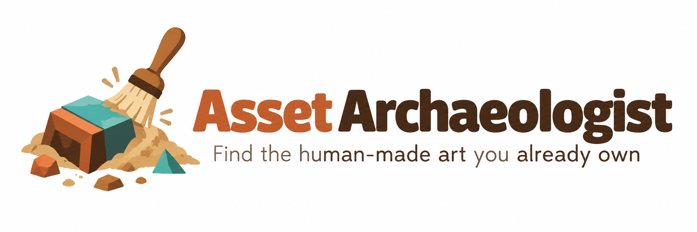
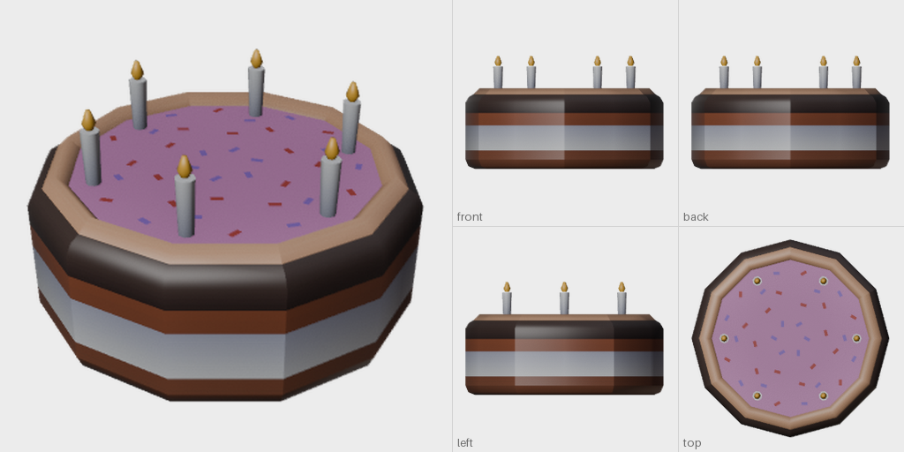
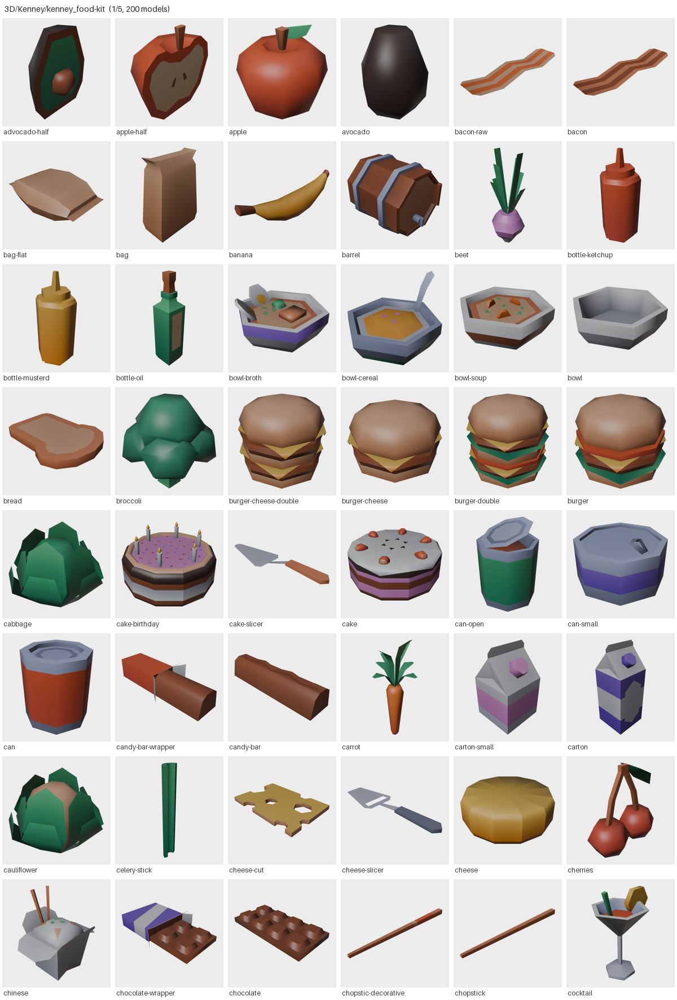

<!-- Logo / wordmark: uncomment when docs/logo.png exists.
<p align="center"></p>
-->

# Asset Archaeologist

**Enable agents to find human art you already own.**

> **Your AI agent can now use the art you paid for.** Ask a coding agent for "a wooden barrel"
> or "a birthday cake" and, without help, it makes one from scratch: a grey box, a generated
> mesh, a placeholder. Meanwhile your drives hold thousands of models made by real artists, in
> packs you already bought. Asset Archaeologist lets the agent search that art by describing it,
> so it picks **human-made work you own** instead of generating its own.

People who make games collect asset packs: Humble bundles, Synty, Kenney, itch.io, Unity
packages, Blender files. Nobody can see what they own, because a pack is a zip of files named
like `SM_Prop_Barrel_01.fbx`. Asset Archaeologist draws every 3D model in your library from five
sides, indexes the pictures with a local image-and-text model (SigLIP), and gives you a search
page in your browser plus a search tool and API for AI agents.

Everything runs on your computer. Nothing is uploaded.

## What you get

For every model, a five-view sheet (3/4 view, front, back, left, top), its size in metres and its
triangle count:



For every pack, contact sheets with every model and its name:



Then search by plain description, in the browser or from an agent:

```text
$ asset-archaeologist find "a red apple" "a birthday cake" "pizza" -k 2

## a red apple
- apple-half  [0.10 x 0.20 x 0.19 m, 124 tris, Assets/Kenney/kenney_food-kit]
    pack: D:/Assets/Kenney/kenney_food-kit.zip  file: Models/GLB format/apple-half.glb
    thumb: .../packs/Assets/Kenney/kenney_food-kit/apple-half.png
    sheet: .../packs/Assets/Kenney/kenney_food-kit/apple-half.sheet.png
- apple  [0.20 x 0.20 x 0.19 m, 136 tris, Assets/Kenney/kenney_food-kit]
    ...

## a birthday cake
- cake-birthday  [0.64 x 0.64 x 0.36 m, 1146 tris, Assets/Kenney/kenney_food-kit]
- cake  [0.64 x 0.64 x 0.27 m, 750 tris, Assets/Kenney/kenney_food-kit]
    ...

## pizza
- pizza  [0.84 x 0.84 x 0.04 m, 1208 tris, Assets/Kenney/kenney_food-kit]
- pie  [0.95 x 0.95 x 0.15 m, 292 tris, Assets/Kenney/kenney_food-kit]
    ...
```

*Pictures: [Kenney Food Kit](https://www.kenney.nl/assets/food-kit) by Kenney (www.kenney.nl),
CC0. Rendered by Asset Archaeologist.*

## Why it helps

- **Agents use your art.** A batch API and command line let an agent send many searches in one
  request and get back file paths, sizes and pictures it can look at. Measured: 4 searches in
  33 ms once the server is warm (the first start takes about 25 s while the model loads).
- **Five views of every model** (front, back, left, top, 3/4) plus contact sheets per pack. Size
  in metres and triangle count are recorded, so you can filter for "between 0.5 and 3 m".
- **Search by description.** Ranking uses the picture and the file name together; picture-only
  search missed things like "pizza" on simple low-poly renders. "More like this" finds models that
  look alike. Filter by pack and by size.
- **Reads packs as they ship.** Zips, `.unitypackage` (no Unity needed), `.blend`, glTF / GLB,
  FBX, OBJ, DAE, folders of loose files, and Unity packages nested inside zips.
- **Handles the usual pack quirks:**
  - Synty-style packs: hides `_Shadow` shadow-caster meshes, collision meshes and LOD1+ (a 13 m
    building used to render as a speck); resolves FBX texture references to the artist's `.psd`
    source to the shipped `_A.png` variants; uses the pack's shared colour atlas when a material
    has no texture; picks the colour map rather than the emissive map; a character file with many
    outfits on one skeleton becomes one entry per outfit.
  - Unity `.unitypackage`: streams the gzipped tar, maps guid to path, keeps models, textures and
    materials, resolves colour textures from `.mat` files (`_BaseColorMap`, `_BaseMap`,
    `_MainTex`, ...), applies the FBX `.meta` material remaps, maps `MI_` instance names to `M_`
    materials, and hides convex-hull collision meshes.
  - `.blend`: one entry per Asset-Browser-marked asset, else per top-level object; falls back to
    the whole scene for huge scenes; ignores asset marks that cover only a small part of the file;
    switches files saved for video output back to still images.
  - Missing textures render as plain material colour, not magenta.
- **One copy per product.** The same pack downloaded several ways (source files + Godot + Unity
  + Unreal) is rendered once, preferring the source files.
- **Safe to stop.** Scans are resumable, partial re-renders merge into the existing pack, and
  paths are kept short for Windows' 260-character limit.
- **Licence files are noted.** Each pack's licence and readme files are listed with the results,
  so an agent can check terms before using a model.

## Setup

You need about 15 minutes, an internet connection for the first run, and roughly 5 GB of free
disk space for the program (most of that is the GPU version of the AI library on computers with
an NVIDIA graphics card; without one it is much smaller).

> **Needs Testing:** The macOS and Linux installers are provided but untested, so each is flagged
> "Needs Testing". If you try one and it works, please leave a comment or submit a PR to remove the
> "Needs Testing" flag; if it doesn't, please open an issue.

### 1. Get the files

Download this project as a ZIP (the green **Code** button on GitHub, then **Download ZIP**) and
unzip it somewhere permanent, for example `Documents\Asset Archaeologist`. (Or `git clone` it.)

### 2. Run the setup script

| System | What to do |
|---|---|
| **Windows** | Double-click **`setup-windows.bat`**. If Windows shows "Windows protected your PC", click **More info**, then **Run anyway**. |
| **macOS** (Needs Testing) | Double-click **`setup-macos.command`**. If macOS refuses, right-click it, choose **Open**, then **Open** again. |
| **Linux** (Needs Testing) | Open a terminal in the folder and run **`./setup-linux.sh`**. |

A window opens and works through five steps. It asks before installing anything outside the
folder. What you will see:

1. **uv**: a small tool that installs Python and the packages. If you don't have it, the script
   asks to install it (from [astral.sh](https://docs.astral.sh/uv/)).
2. **Python environment**: a private Python 3.12 inside the app folder (`.venv`). Nothing is
   installed system-wide.
3. **Packages**: the long step (5 to 15 minutes). With an NVIDIA GPU you get the GPU version of
   torch; without one, the CPU version. Both work; the CPU is just slower.
4. **Blender**: it looks for Blender 4.2 or newer. If it is missing, it offers to install it
   (Windows: `winget`; macOS: Homebrew; Linux: `snap`) or opens
   [blender.org/download](https://www.blender.org/download/), the one place to get it.
5. **Search model**: downloads SigLIP (about 800 MB, once) and runs a final check. Every line
   should say `ok` (a `warn` about library folders is normal at this point).

On Windows it also offers a desktop shortcut.

### 3. Start it and choose your folders

Double-click **`start-windows.bat`** (macOS: `start-macos.command`; Linux: `./start-linux.sh`), or
the desktop shortcut. Keep the window that opens; closing it stops the program. Your browser
opens **http://127.0.0.1:8790/**.

The first time, the page shows **Set up Asset Archaeologist**:

1. Click **Add a folder…** and pick the folder that holds your asset packs (zips, Unity packages,
   Blender files, folders of models). The folder chooser can open behind the browser window.
   Add as many folders as you like. Sub-folders are included.
2. Check where thumbnails go and the scratch folder (pick a drive with a few GB free). The
   defaults are fine for most people.
3. Click **Start scan**. A progress bar shows the pack it is on and how many models are done.

How long it takes: about 0.6 s per model with 3 Blender processes on a laptop with an NVIDIA
RTX 3050 Ti, so roughly 10 minutes per 1,000 models; slower without an NVIDIA GPU. You can
search while it runs, and stop and continue later: the next scan picks up where the last one
stopped. Disk use is about 230 KB per model.

### 4. Search

Type what you need ("a wooden barrel", "a red apple", "a sci-fi crate") and press Enter. Click a
result for its five-view sheet, size, triangle count and the file inside the pack; **More like
this** finds models that look similar; **Copy paths** copies where it is.

Afterwards you never need the terminal: double-click the start launcher and use the page.

### 5. Point your AI agent at it

Tell your agent (Claude Code, Cursor, Codex, ...) something like:

> Before making any 3D asset, search my own asset library. Instructions:
> http://127.0.0.1:8790/llms.txt

or give it the command line tool. The Settings page shows the exact command for your computer;
it looks like this:

```text
Windows:      "C:\...\Asset Archaeologist\.venv\Scripts\asset-archaeologist.exe" find "wooden barrel" "goblin hut" --json
macOS/Linux:  ".../Asset Archaeologist/.venv/bin/asset-archaeologist" find "wooden barrel" "goblin hut" --json
```

The command starts the search server by itself if it is not running (about 25 s the first
time), then answers in milliseconds. One call can carry many searches.

## For agents and scripts

`/llms.txt` on the running server explains all of this to an agent. The API is local JSON:

| Request | What it does |
|---|---|
| `POST /api/batch` `{"queries": [{"q": "wooden barrel", "k": 8}, {"q": "goblin hut", "pack": "Synty"}]}` | many searches in one request (send `Content-Type: application/json`) |
| `GET /api/search?q=wooden+barrel&k=12` | one search |
| `GET /api/similar?pack=<pack>&model=<model>&k=12` | models that look like a result |
| `GET /api/packs` | every indexed pack with its source file, licence files and contact sheets |
| `GET /api/ping` | `{"ok": true, "ready": true}` once the model has loaded |

Filters on searches: `pack=<text in the pack name>`, `min_m` / `max_m` (largest side in
metres), `by=both|image|name`. Each result has `name`, `pack`, `pack_file` (the zip, package,
.blend or folder on disk), `model` (the file inside it; `file#part` when one file holds several
models), `size_m`, `tris`, `texture`, `tags`, and `thumb` / `sheet` (PNG paths an agent can open
and look at).

## Command line

```text
asset-archaeologist scan              render + index every pack still to do (resumable)
asset-archaeologist scan --plan       list what would be scanned
asset-archaeologist scan PATH...      only these packs   (--procs N, --force, --only REGEX, --limit N)
asset-archaeologist serve --open      the browser page and API
asset-archaeologist find "q1" "q2"    search (-k 8, --pack, --min-m, --max-m, --by, --json)
asset-archaeologist similar PACK MODEL
asset-archaeologist doctor            check Blender, GPU / torch, settings, disk space (--fetch-model)
asset-archaeologist config            show settings (--add-library DIR, --set key=value, --json)
asset-archaeologist tag               re-score every model against the tag list
```

## Settings

Settings live in `config.toml`, edited on the Settings screen or by hand:

- Windows: `%APPDATA%\AssetArchaeologist\config.toml`
- macOS: `~/Library/Application Support/AssetArchaeologist/config.toml`
- Linux: `~/.config/asset-archaeologist/config.toml`

A `config.toml` in the app folder is used instead if it exists (a portable install), and the
`ASSET_ARCHAEOLOGIST_CONFIG` environment variable overrides both.

| Setting | Meaning |
|---|---|
| `libraries` | folders holding your asset packs |
| `output` | thumbnails, sheets, indexes and search data (default: app-data folder) |
| `work` | scratch space for unpacking while rendering (default: system temp) |
| `blender` | Blender executable; empty = found automatically |
| `port` | the page and API port (default 8790) |
| `procs` | Blender processes at once (default 2) |
| `device` | `auto`, `cuda`, `mps` or `cpu` |
| `priority` | optional regular expressions; matching packs are scanned first |
| `folder_pack_depth` | how loose model folders are grouped into packs (1: `Library/<pack>/...`, 2: `Library/<vendor>/<pack>/...`) |
| `model_cache` | optional folder for the SigLIP download (sets `HF_HOME`) |

To change the tag list, copy `src/asset_archaeologist/tag_set.json` next to your `config.toml`,
edit it, and run `asset-archaeologist tag`.

## Requirements

- **Blender 4.2 or newer** ([blender.org](https://www.blender.org/download/)). Asset
  Archaeologist starts Blender as a separate program and exchanges files with it; it does not
  include or link Blender's code, so Blender's GPL licence does not apply to this project's code.
- **Python 3.11+** and the packages in `pyproject.toml`: torch, torchvision, open_clip_torch,
  timm, huggingface_hub, transformers + sentencepiece (the SigLIP text tokenizer), numpy, Pillow. The setup scripts install all of this with
  [uv](https://docs.astral.sh/uv/).
- **SigLIP weights** (`ViT-B-16-SigLIP-384`, `webli`; Apache-2.0), about 800 MB, downloaded once
  from Hugging Face.
- An NVIDIA GPU is optional. Without one, rendering and indexing run on the CPU, just slower.
  Apple Silicon Macs use the Apple GPU for indexing.
- Disk: about 230 KB per model for the output, plus scratch space for the largest pack while it
  renders.

Measured on a laptop with an NVIDIA RTX 3050 Ti: about 0.6 s per model with 3 Blender
processes; 4 searches in 33 ms with the server warm; about 25 s for the first start while SigLIP
loads. With indexing on the CPU instead, the same 4 searches took about a quarter of a second, and the
200-model Kenney Food Kit took 21 minutes end to end with one Blender process (on a machine
busy with another job).

## Privacy

The server listens on `127.0.0.1` only and refuses requests from other web pages. Your packs
are read, never modified. The only downloads are the setup itself and the SigLIP weights.

## Troubleshooting

- **Run `asset-archaeologist doctor`** (or look at the last lines of the setup window). Every
  line marked `FAIL` says what to do.
- **"Blender was not found"**: install it from [blender.org](https://www.blender.org/download/),
  or type its path on the Settings screen.
- **A pack failed**: the scan log is `scan.log` in the output folder; `_scan_state.json` lists
  every pack's outcome. Run the scan again to retry; finished packs are skipped.
- **Port in use**: another copy is probably running; open http://127.0.0.1:8790/. Or set `port`.
- **Low disk space on the system drive**: set `output`, `work` and `model_cache` to another
  drive. To put the setup's download cache elsewhere, set the `UV_CACHE_DIR` environment
  variable before running setup.

## Licence

MIT, copyright Jeff Neet (CrossBread). See [LICENSE](LICENSE).

The example pictures in `docs/` show the [Kenney Food Kit](https://www.kenney.nl/assets/food-kit)
by Kenney (www.kenney.nl), released under CC0. Packs you scan keep their own licences; check
each pack's licence before shipping its art.

## Support and credits

If Asset Archaeologist saves you time, you can [buy Jeff a coffee on Ko-fi](https://ko-fi.com/jeffneet).

Made by Jeff Neet. For help with games, tools or AI workflows, Jeff consults through Joybringr:
[jeffneet.com/joybringr/consulting](https://jeffneet.com/joybringr/consulting).

Built on [Blender](https://www.blender.org/), [OpenCLIP](https://github.com/mlfoundations/open_clip)
and Google's [SigLIP](https://arxiv.org/abs/2303.15343).
